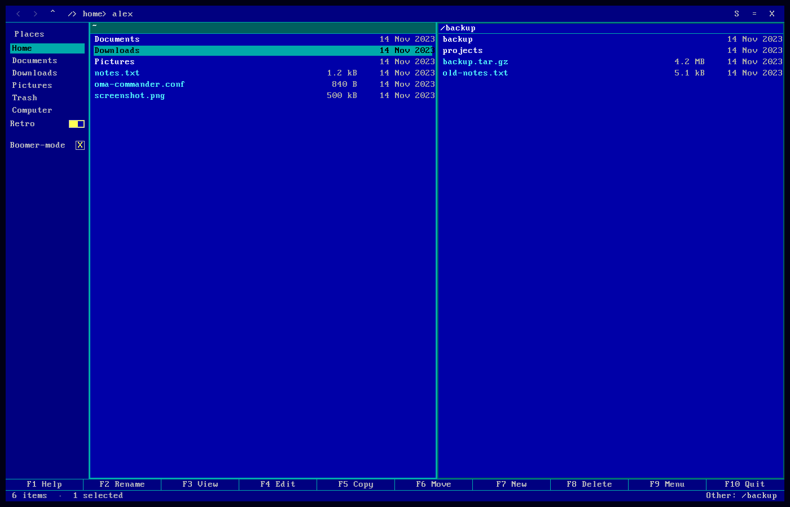

# OmaNCommander for Omarchy

OmaNCommander is a Nautilus-shaped file manager that runs as an Omarchy shell overlay. It has
the familiar places sidebar, header breadcrumbs, icon and list views, search,
trash, rename/copy/move, and a proper properties dialog. On top of that it has
the two-pane keyboard flow of
[OMARCHOMANDER](https://github.com/asfarsadewa/omarchy-omarchomander): two
independent folders, Tab to switch, F5/F6 to copy or move between them.

This is not a fork of GNOME Files and it does not embed GTK. The window is
drawn with the Omarchy shell theme tokens (colors, corner radius, font scale)
and the filesystem work happens in a small Python backend, so it follows the
active Omarchy theme and needs no extra packages.



## Dependencies and permissions

- Omarchy Quattro 4.0.6 (stable) or newer, including 4.5.0-rc. The overlay
  draws its own layer-shell window, so it does not depend on shell helpers
  that only exist in 4.5.
- Python 3 (standard library only).
- GIO (`gio open`) for opening files in the desktop default application.
- The IBM VGA font is bundled; no font package is required.
- The plugin runs inside the long-lived Omarchy shell with your user
  permissions. The Python backend has no network access, does not use a shell
  for file operations, and does not request root. It can read and write every
  file you can.
- It starts one backend process for the plugin, not a second Quickshell.

## Install

On Omarchy 4.0.6 or newer:

```bash
cp -r omancommander ~/.config/omarchy/plugins/popkenr.omancommander
omarchy plugin validate ~/.config/omarchy/plugins/popkenr.omancommander
omarchy plugin enable popkenr.omancommander
```

Or publish the repo and install it the normal way:

```bash
omarchy plugin add https://github.com/popken-it/omacommander.git
omarchy plugin enable popkenr.omancommander
```

If you still have an older install (`popkenr.files` or `popkenr.omacommander`),
remove it first:

```bash
omarchy plugin disable popkenr.files
omarchy plugin remove popkenr.files
omarchy plugin remove popkenr.omacommander
```

To remove it:

```bash
omarchy plugin remove popkenr.omancommander
```

Places state stays at `$XDG_STATE_HOME/omarchy/files-places.json`; delete it
if you do not want to keep it.

A folder icon appears in the bar. Click it to open OmaNCommander. A hotkey is not
installed by default; add one to `~/.config/hypr/bindings.conf`:

```conf
bindd = SUPER SHIFT, N, OmaNCommander, exec, omarchy-shell shell toggle popkenr.omancommander '{}'
```

Then `hyprctl reload`. The same command works from a terminal.

## Keys

The clickable bar above the status line is the Total Commander function-key
bar:

| Key | Action |
|---|---|
| `F1` | Help |
| `F2` | Rename |
| `F3` | View the file: text, hex for binary files, or an image |
| `F4` | Edit in the Omarchy editor |
| `F5` | Copy the selection to the other pane |
| `F6` | Move the selection to the other pane |
| `F7` | New folder |
| `F8` | Move to Trash (in Trash: delete permanently) |
| `F9` | Open the menu |
| `F10` | Close OmaNCommander |
| `Shift+F6` | Rename (the Total Commander alias) |
| `Shift+F8` | Delete permanently |
| `Alt+F4` | Close OmaNCommander |

`F5` and `F6` need the second pane; the bar tells you so when it is off.
Total Commander itself uses `F2` to reread; this keeps `F2` for rename and
`Ctrl+R` for reload.

Other keys:

| Key | Action |
|---|---|
| `Enter` | Open the item / enter the folder |
| `Backspace`, `Alt+Up` | Parent folder, with the cursor on the folder you left |
| `Alt+Left` / `Alt+Right` | Back / forward |
| `Ctrl+L` | Type a location |
| `Ctrl+F` or just typing | Search this folder and below |
| `Esc` | Clear search/menu/dialog/viewer, otherwise close |
| `Ctrl+H` | Show hidden files |
| `Ctrl+D` | Add the current folder to Places |
| `Ctrl+Shift+R` | Toggle Retro Norton Commander colours |
| `Ctrl+Shift+U` | Toggle Boomer-mode 9x16 text mode (only with Retro on) |
| `Ctrl+=` / `Ctrl+-` | Larger / smaller text |
| `Ctrl+0` | Reset text to 120% |
| `Ctrl+R` | Reload |
| `Ctrl+A` | Select all |
| `Ctrl+C` / `Ctrl+X` / `Ctrl+V` | Copy / cut / paste |
| `Delete` | Move to Trash; asks "Are you sure?" (Yes or Enter) |
| `Shift+Delete` | Delete permanently; asks "Are you sure?" (Yes or Enter) |
| `Ctrl+Shift+N` | New folder |
| `Ctrl+I` | Properties |
| `Ctrl+W` | Close OmaNCommander |

Two-pane keys, from OMARCHOMANDER:

| Key | Action |
|---|---|
| `Ctrl+Shift+D` | Show or hide the second pane |
| `Tab` | Switch the active pane |
| `Ctrl+U` | Swap the two panes |

In a split view each pane shows its own path strip; the active one is
highlighted. Only the active pane shows the cursor/selection. Clicking
anywhere in a pane makes it the active one; `Tab` does the same.

## What it does

- Sidebar with Home, XDG folders, Trash, Computer, and removable volumes under
  `/run/media/<user>` and `/media/<user>`.
- Add any folder to the sidebar with *Add This Folder to Places* (`Ctrl+D`) or
  by right-clicking a folder. Saved places persist between sessions; hover a
  saved place and click `✕` to remove it. They live in
  `$XDG_STATE_HOME/omarchy/files-places.json`.
- Nautilus layout: header bar, breadcrumbs that scroll to the deepest segment,
  icon grid with image thumbnails, list view with sortable columns, status bar
  with item/selection size and free space.
- Starts in dual-pane and list view at 120% text. The `A−` / `A+` buttons at
  the top right scale the interface text from 80% to 160%.
- A **Retro** switch at the bottom of the sidebar turns the colours into the
  classic Norton Commander blue/cyan/yellow palette.
- **Boomer-mode** (only available with Retro) renders the whole window in the
  IBM VGA 9x16 text font and turns both panes into flat text-mode panels: no icons,
  cyan selection bar, white folders, cyan files, square double borders, and a
  blue gutter on both sides of the pane borders.
- The plugin version is shown at the bottom of the sidebar, above the
  function-key bar.
- Search below the current folder, case-insensitive, capped at 400 results.
- Freedesktop home trash: move, list with original location, restore, empty.
  Items land in `$XDG_DATA_HOME/Trash`, so other file managers can restore them.
- Copy/move with per-file Replace/Skip/Cancel on conflicts, merge for folders,
  cross-filesystem moves, a Total Commander-style progress box (file, bytes,
  speed, time left) and Cancel.
- Rename, new folder, permanent delete, properties, and opening files in the
  default application for their type (via GIO). Deleting always asks first.
- If a folder shown in a pane is moved or deleted, that pane moves up to the
  nearest existing parent instead of staying on a dead path.
- Total Commander-style function-key bar and `F3` lister (text, hex, images).
- Hidden files, sorting by name/size/modified, grid/list toggle.
- The main actions have a keyboard path; sidebar rows and the Retro switch
  also work with the mouse.

## Deliberate limits

Kept out to keep this one process, no extra dependencies, and no risky magic:

- No drag and drop, tabs, multiple windows, Recent/Starred, network or GVfs
  mounts, "Open With", compression, batch rename, permission editing, or undo.
- Trash support is the home trash only. Trashing across filesystems is refused
  with a clear message; per-volume `.Trash-$uid` support is not implemented.
- Search is a bounded filesystem walk, not Tracker. Very large trees stop at
  400 results or 20 seconds. Folders with more than 10,000 visible entries show
  the first 10,000 and say that more are hidden.
- The lister shows text, a hex dump for binaries, and images. PDF, video,
  archives and office documents still go to their default application.
- Open folders last for the shell session; saved Places persist across restarts.

## Boomer-mode font

`fonts/Px437_IBM_VGA_9x16.ttf` comes from VileR's
[Oldschool PC Font Resource](https://int10h.org/oldschool-pc-fonts/fontlist/font?ibm_vga_9x16)
and is licensed CC BY-SA 4.0. The full license and original readme are in
`fonts/LICENSE.TXT` and `fonts/README.TXT`. The plugin code remains MIT.

## Backend and tests

`backend/filesd.py` speaks one JSON object per line on stdin/stdout. Read-only
commands run on short-lived threads; search is cancellable and does not block
listings. One mutating operation at a time runs on a worker thread, so the
window keeps painting, can show progress, and can cancel. Standard library only:

```bash
./scripts/check
```

That runs the backend tests, a `SyntaxWarning`-as-error compile and the
manifest/entry-point checks. On an Omarchy machine with `OMARCHY_PATH` set it
also runs `qmllint` and the QML navigation tests in `tests/ui`; elsewhere those
steps are skipped. The Python checks run in GitHub Actions.

## License

MIT. The two-pane key design and the name OMARCHOMANDER belong to Asfar
Sadewa; this plugin does not share its code.
